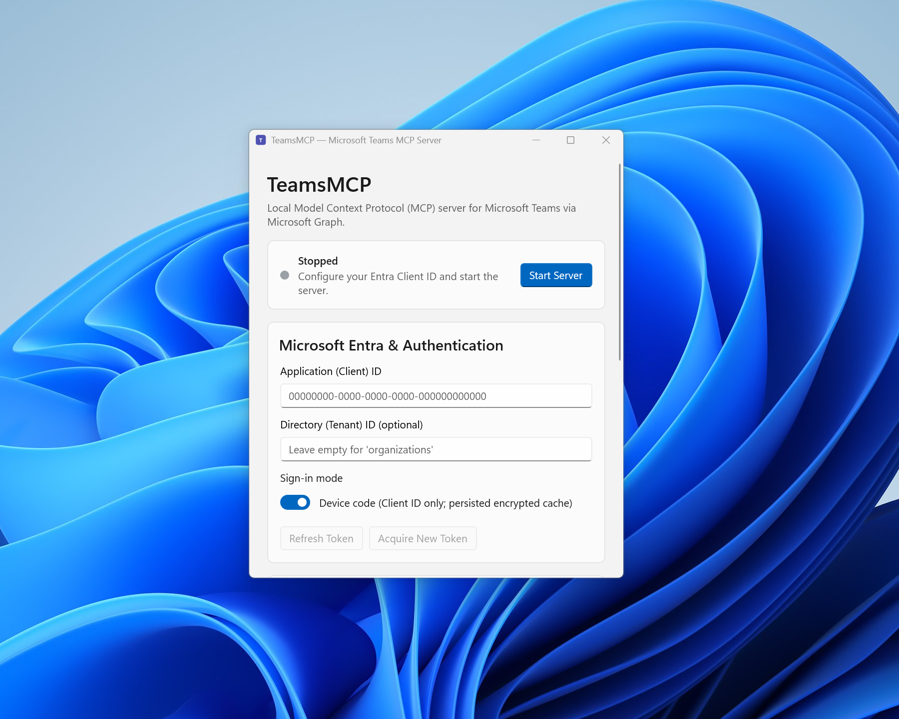

# TeamsMCP

Connect your AI assistant—such as **Visual Studio Code**, **GitHub Copilot CLI**, or **Claude Desktop**—to **Microsoft Teams** directly from your Windows PC.

TeamsMCP runs a local **Model Context Protocol (MCP)** server on your machine (`127.0.0.1` only) and signs in directly to Microsoft Graph with your Microsoft 365 account. Your messages never pass through a third-party cloud service.



---

## What You Can Do

- **Read Teams conversations** — List your 1:1, group, and meeting chats, read recent messages, and follow channel threads and replies.
- **Work with inline images** — Let your AI assistant view inline images from chats and channels, or save them to a local folder you choose.
- **Post to channels** — Publish plain-text messages to Teams channels (`send_channel_message`), enabled by default and toggleable to read-only mode at any time.
- **Run quietly in the background** — Lives in your Windows system tray with a live running/stopped indicator, quick actions, and optional auto-start when you sign in to Windows.
- **Keep everything local** — Binds exclusively to `127.0.0.1` on your PC, with Windows-encrypted local token caching.

---

## Getting Started

### 1. Requirements

- **Windows 10 (1809+) or Windows 11** (`x64` or `ARM64`).
- A **Microsoft 365 work or school account** with access to Microsoft Teams.
- A **Microsoft Entra ID Application (Client) ID** (either created in your organization's Microsoft Entra admin center or provided by your IT administrator).

### 2. Set Up a Microsoft Entra App Registration

If you don't already have a Client ID from your IT team:

1. Open the [Microsoft Entra admin center](https://entra.microsoft.com) → **App registrations** → **New registration**.
2. Give it a name (for example, `TeamsMCP`) and click **Register**.
3. Copy the **Application (client) ID** (and optionally the **Directory (tenant) ID**).
4. Under **Authentication**:
   - Add a **Mobile and desktop applications** platform.
   - Enable **Allow public client flows** *(required for Device Code sign-in)*.
   - *(Optional)* If you want to use **Windows Broker** sign-in, add the redirect URI `ms-appx-web://microsoft.aad.brokerplugin/<your-client-id>`.
5. Under **API permissions** → **Add a permission** → **Microsoft Graph** → **Delegated permissions**, add:
   - `User.Read`
   - `Chat.Read`
   - `Team.ReadBasic.All`
   - `Channel.ReadBasic.All`
   - `ChannelMessage.Read.All`
   - `Files.Read.All`
   - `ChannelMessage.Send` *(required for posting messages to channels; optional if you switch to read-only mode)*
6. If your organization requires admin approval for Teams scopes, ask an Entra administrator to click **Grant admin consent**.

### 3. Configure and Start TeamsMCP

1. Launch **TeamsMCP**.
2. Paste your **Application (Client) ID** (and optional **Directory (Tenant) ID**—leave blank to use `organizations`).
3. Choose your preferred **Sign-in mode**:
   - **Device code** *(default)* — Signs in via your browser using a short code and saves an encrypted session locally so you don't have to sign in every time.
   - **Windows Broker** — Uses your Windows account sign-in dialog.
4. Click **Start Server**.
5. When prompted, complete the Microsoft sign-in flow. Once signed in, the status indicator turns green and displays your local MCP URL (default: `http://127.0.0.1:5123/mcp`).

### 4. Connect Your AI Assistant

Expand **MCP Client Configuration** at the bottom of the TeamsMCP window and click **Copy JSON Configuration**, then paste it into your MCP client's configuration file (VS Code, GitHub Copilot CLI, Claude Desktop, etc.):

```json
{
  "mcpServers": {
    "teams-mcp": {
      "type": "http",
      "url": "http://127.0.0.1:5123/mcp"
    }
  }
}
```

*(If you change the loopback port in TeamsMCP, the snippet updates automatically.)*

---

## Settings & System Tray

### Server & Permissions
- **Loopback Port** — Local port for the MCP endpoint (`1024`–`65535`, default `5123`). Only accepts connections from `127.0.0.1`.
- **Allow posting channel messages** — Enabled by default. Turn off at any time to restrict your AI assistant to read-only access.
- **Allow saving Teams inline images** — Controls whether your AI assistant can save inline images to disk and lets you browse for the destination folder.

### Startup & System Tray
- **Auto-start server on launch** — Automatically starts the MCP server whenever TeamsMCP opens.
- **Start minimized to tray** — Opens directly into the system tray without showing the configuration window.
- **Minimize to tray on close** — Keeps the MCP server running in the tray when you close the window.
- **Launch at Windows sign-in** — Starts TeamsMCP automatically when you log in to Windows (can also be managed in Windows **Settings → Apps → Startup**).

### Tray Icon Actions
- **Click** the tray icon to open or bring the TeamsMCP window to the front.
- **Right-click** the tray icon for quick actions: **Open**, **Start / Stop Server**, **Copy MCP URL**, **Refresh Token**, and **Exit**.

---

## Tools Available to Your AI Assistant

Once connected, your MCP client can use these tools:

| Tool | Description |
| --- | --- |
| `list_chats` | List your 1:1, group, and meeting chats |
| `read_chat_messages` | Read messages from a chat (newest first) |
| `list_teams` | List Teams you belong to |
| `list_channels` | List channels in a Team |
| `read_channel_messages` | Read root posts in a channel |
| `read_channel_replies` | Read replies to a channel thread |
| `read_chat_image` / `read_channel_image` | View inline images from chat or channel messages |
| `save_chat_image` / `save_channel_image` | Save inline images to your configured local folder |
| `send_channel_message` | Post a plain-text message to a Teams channel *(when enabled)* |

---

## Privacy & Security

- **Local-only server:** TeamsMCP listens exclusively on `127.0.0.1` and never exposes your Teams data to the network.
- **Encrypted token cache:** Cached OAuth tokens are stored locally and encrypted with Windows DPAPI tied to your Windows user account.
- **No telemetry or third-party servers:** All Microsoft Graph requests go directly from your PC to Microsoft.

See [PRIVACY.md](PRIVACY.md) for the full Privacy Policy.

---

## Troubleshooting

- **"Need admin approval" during sign-in:** Your organization restricts user consent for Microsoft Teams Graph permissions. Ask your IT administrator to grant admin consent for your Entra App Registration.
- **Port already in use:** Change the **Loopback Port** to another unused port between `1024` and `65535`, click **Start Server**, and update your MCP client config with the new URL.
- **Token expired or sign-in errors:** Use **Refresh Token** (from the main window or tray menu) or click **Acquire New Token** to sign in again.
- **Launch at Windows sign-in is disabled:** If you previously turned off TeamsMCP in Windows Task Manager or Startup Apps, re-enable it under **Windows Settings → Apps → Startup**.

---

## License

See [LICENSE](LICENSE) for license details.
